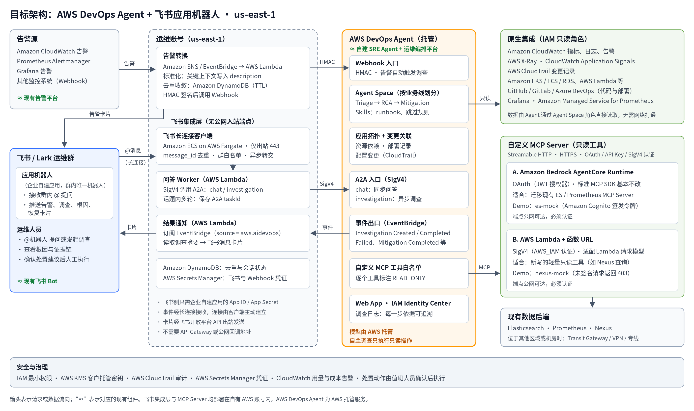
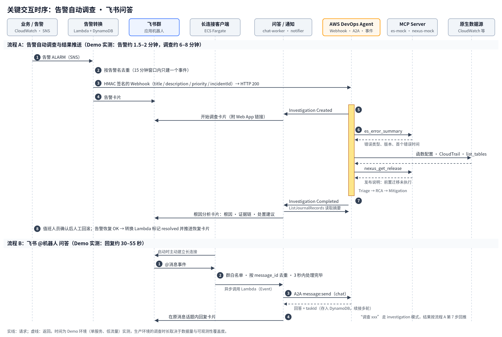
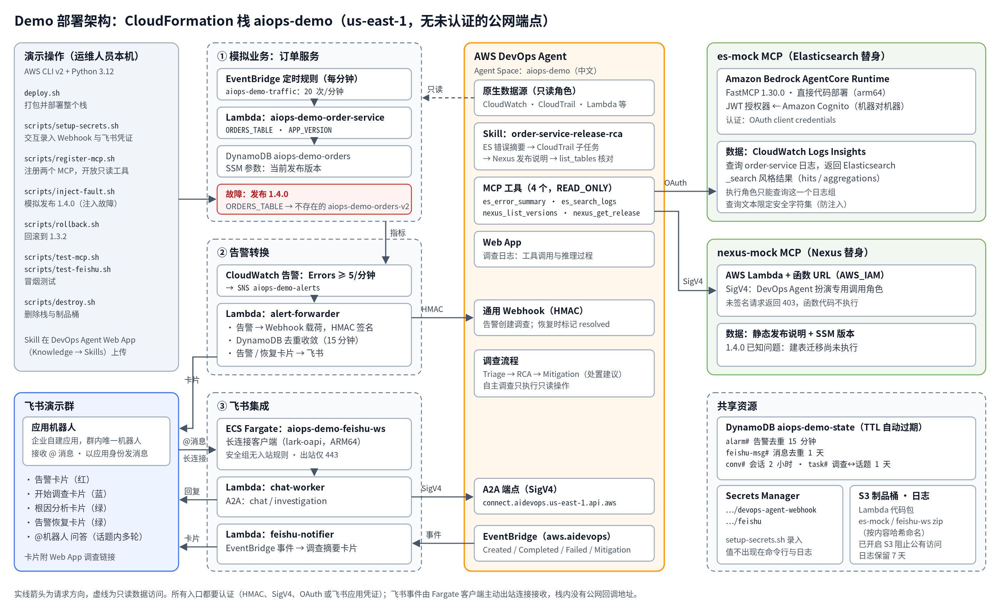

# 基于 AWS 的智能运维（AIOps）落地方案

以 AWS DevOps Agent 为核心，复用现有 MCP Server 与飞书协作流程

| 项目 | 内容 |
|---|---|
| 版本 | 1.0（2026-10-22） |
| 部署区域 | 美国东部（弗吉尼亚北部）us-east-1 |
| 文档性质 | 方案建议、Demo 验证结果与 PoC 计划，供双方评审 |
| 配套文档 | 《02-设计文档》：组件与交互的详细设计；《03-部署手册》：Demo 环境的分步部署说明（含飞书应用配置） |

> 文中涉及数据合规的内容仅为技术说明，不构成法律意见，具体结论以法务与合规团队的评估为准。

---

## 1. 摘要

- **推荐方案**：以 **AWS DevOps Agent** 作为“SRE Agent + 根因分析平台”的核心，承担现有自建 SRE Agent 与运维编排平台的调查编排、拓扑关联与根因定位职责。告警转换、飞书集成等胶水逻辑用 AWS Lambda 与 Amazon ECS on AWS Fargate 实现，二期可按需引入 **Amazon Bedrock AgentCore** 承载自定义 Agent（如自动生成修复 PR）。
- **已有落地验证**：DevOps Agent 已在多家企业生产落地，例如 Habby（MTTR 由约 2 小时降至 20 分钟）、ADF（接入自建 ELK 等 MCP，基础设施事件 MTTR 降低 64%）、Daimler Truck（DevOps Agent + AgentCore 组合，单事件处理时间降低约 88%），详见第 6 章。
- **飞书体验保持不变**：飞书群里只保留一个应用机器人，既推送告警、调查、根因、恢复卡片，也接受 @ 提问。飞书事件通过**长连接**接收，连接由自有 AWS 账号内的客户端主动建立，不需要对公网开放任何回调地址。
- **复用现有 MCP Server**：现有的 Elasticsearch、Prometheus、Nexus MCP Server 满足协议与认证要求后即可注册接入；托管方式可在 AgentCore Runtime 与 Lambda 两种之间选择，Demo 中均已实现（4.4.3）。
- **Demo 已端到端跑通**：在 us-east-1 搭建的“发布后故障”演示场景中完成 4 次完整演练，根因判定 4 次全部正确，从告警到根因结论约 6–8 分钟，两类自定义 MCP 工具均被实际调用（第 5 章）。
- **落地前提与节奏**：需完成 17 项先决条件（第 7 章），建议 4 周 PoC，以 20–50 起历史事故回放作为验收基线；PoC 期间可使用 DevOps Agent 新客户免费试用额度。

---

## 2. 现状与目标

### 2.1 现有架构

以一种常见的自建 AIOps 架构为例：

```
现有告警平台 ─────┐
开发 / 运维提问 ──┴─> 飞书机器人 ─> 自建 SRE Agent ─┬─> Elasticsearch MCP Server（日志）
                                                   ├─> Prometheus MCP Server（指标）
                                                   ├─> Nexus MCP Server（制品）
                                                   ├─> 运维编排平台（全域观测与根因分析）
                                                   └─> 本地部署的开源大模型
```

### 2.2 目标

1. 在 AWS 侧保留并增强“告警进来、机器人给出根因与处置建议”的体验。
2. 用托管服务替代自建 Agent 编排、模型部署与拓扑关联，降低维护成本。
3. 全过程可审计、权限可控，处置动作保留人工确认。
4. 效果可度量：以根因命中率和平均定位时间作为验收指标。

### 2.3 设计原则

| 原则 | 含义 |
|---|---|
| 托管优先 | 能用托管能力的不自建，自建部分只保留与企业特有系统（飞书、Nexus）的集成 |
| 复用资产 | 现有 MCP Server、runbook、告警规则尽量沿用 |
| 只读起步 | 一期只开放只读数据访问，处置建议由人工确认后执行 |
| 最小暴露面 | 不新增未经认证的公网入口；飞书事件经出站长连接接收 |
| 用数据说话 | 用历史事故回放评估效果，再决定生产推广范围 |

---

## 3. 方案选型

### 3.1 AWS DevOps Agent 简介

AWS DevOps Agent 是 AWS 提供的托管运维 Agent，面向事件响应、可靠性改进和日常 SRE 任务，核心能力包括：

- **自主事件调查**：告警触发后自动开始调查，关联指标、日志、链路、部署与配置变更，给出根因与证据链。
- **分阶段 Agent**：Triage（分诊、去重、判断是否需要调查）→ RCA（根因分析）→ Mitigation（处置方案）。
- **应用拓扑**：自动发现账号内资源及依赖关系，作为关联分析的基础。
- **Skills**：将团队的 runbook、排障经验、跳过规则以 Markdown 形式沉淀，并可指定在哪个阶段生效。
- **按需 SRE 对话**：自然语言查询架构、指标、告警状态、部署历史；可创建定时或事件触发的自定义 Agent（如每日健康日报）。
- **开放集成**：原生集成 CloudWatch、Grafana、Datadog、Dynatrace、New Relic、Splunk、GitHub、GitLab、Azure DevOps、ServiceNow、PagerDuty、Slack；通过 MCP 接入自定义数据源；通过 Webhook、A2A 端点被外部系统调用；调查事件发送到 Amazon EventBridge。

### 3.2 DevOps Agent 与 Bedrock AgentCore 的分工

| 维度 | AWS DevOps Agent | Amazon Bedrock AgentCore |
|---|---|---|
| 定位 | 开箱即用的运维 Agent 产品 | 构建和运行自定义 Agent 与 MCP Server 的平台 |
| 本方案中的角色 | **一期核心**：调查、根因分析、处置建议、对话 | **一期可选**：托管现有 MCP Server；**二期可选**：自定义 Agent，如自动生成修复 PR |
| 模型 | AWS 托管，无需自行部署 | 可自选模型（含 Amazon Bedrock 上的 Qwen、DeepSeek） |
| 交付周期 | 配置 + 集成，周级 | 需开发与测试，月级 |

### 3.3 现有组件与 AWS 方案映射

| 现有组件 | AWS 方案 | 说明 |
|---|---|---|
| 现有告警平台 | CloudWatch 告警 / Prometheus Alertmanager / Grafana 告警 → 告警转换 Lambda → DevOps Agent Webhook | 告警标准化、去重收敛后触发调查 |
| 飞书 Bot | 飞书企业自建应用（应用机器人）+ 飞书集成层（Fargate 长连接客户端、问答 Lambda、通知 Lambda） | DevOps Agent 无原生飞书集成，集成层负责收发；群内只需一个机器人 |
| 自建 SRE Agent | AWS DevOps Agent | 托管，无需自建编排与模型 |
| Elasticsearch MCP Server | 注册为自定义 MCP；建议托管在 AgentCore Runtime | 标准 MCP SDK 实现的 Server 基本无需改动 |
| Prometheus MCP Server | 原生 Grafana 集成，或注册为自定义 MCP | 使用 Amazon Managed Service for Prometheus 时有官方参考实现 |
| Nexus MCP Server | 注册为自定义 MCP；可托管在 AgentCore Runtime 或 Lambda | 用于回答“故障前后部署了哪个制品版本” |
| 运维编排 / 根因分析平台 | DevOps Agent 应用拓扑 + CloudWatch / X-Ray / CloudTrail 关联 | AWS 无一对一的单一产品，由以上能力组合覆盖 |
| 本地部署的开源大模型 | DevOps Agent 托管模型 | 见 3.4 |

### 3.4 模型策略说明

- DevOps Agent 使用 AWS 托管的推理模型，**不支持替换为自选模型**；无需再部署、扩缩和维护 GPU 推理集群。
- 在 us-east-1，DevOps Agent 的推理请求在美国境内处理，数据存储在 Agent Space 所在区域。
- 若二期自建 Agent（AgentCore）希望继续使用开源模型，us-east-1 的 Amazon Bedrock 提供按需调用的 Qwen3 系列与 DeepSeek V3.2 等模型，无需自建推理集群。

---

## 4. 目标架构

### 4.1 架构图



### 4.2 组件清单

| 层 | AWS 服务 / 组件 | 作用 | 部署位置 |
|---|---|---|---|
| 调查分析 | AWS DevOps Agent（Agent Space、Skills、Web App） | 自动调查、根因分析、处置建议、对话 | AWS 托管，us-east-1 |
| 告警接入 | Amazon SNS / Amazon EventBridge、AWS Lambda、Amazon DynamoDB | 告警标准化、去重收敛、HMAC 签名后调用 Webhook，并推送告警卡片 | 运维账号 |
| 飞书事件接收 | Amazon ECS on AWS Fargate（长连接客户端） | 主动连接飞书开放平台接收 @ 消息，去重、过滤后转交问答 Lambda | 运维账号，仅出站 |
| 飞书问答 | AWS Lambda（问答 Worker）、Amazon DynamoDB | 调用 DevOps Agent A2A 端点，回复到飞书话题，保存多轮会话 | 运维账号 |
| 结果推送 | Amazon EventBridge 规则、AWS Lambda（通知） | 订阅调查事件，读取调查摘要，以应用机器人身份发送卡片 | 运维账号 |
| 凭证 | AWS Secrets Manager | 飞书 App ID / App Secret、Webhook 签名密钥 | 运维账号 |
| 自定义数据源 | Amazon Bedrock AgentCore Runtime 或 AWS Lambda | 承载 ES / Prometheus / Nexus MCP Server（4.4.3） | 运维账号 |
| 网络 | AWS Transit Gateway / VPN / AWS Direct Connect | 数据后端不在 us-east-1 时打通到运维 VPC | 企业网络 |
| 原生数据源 | Amazon CloudWatch、AWS X-Ray、AWS CloudTrail、Amazon EKS / ECS / RDS 等、GitHub / GitLab | 指标、日志、链路、变更、代码与部署 | 业务账号 |
| 身份与治理 | AWS IAM Identity Center、AWS KMS（客户托管密钥）、AWS CloudTrail、CloudWatch 告警 | 登录、加密、审计、用量与成本告警 | 管理 / 运维账号 |

### 4.3 关键流程



**流程 1：告警自动调查**

1. 告警经 SNS 或 EventBridge 进入告警转换 Lambda。
2. Lambda 将告警标准化，把服务名、环境、告警表达式、当前值写入 `description`；按告警名做去重收敛；用 HMAC 签名后调用 DevOps Agent Webhook，调用成功后再向飞书群推送告警卡片。
3. DevOps Agent 在 Triage 阶段判断是否需要调查，随后进入 RCA，查询原生数据源与 MCP 数据源，并按 Skills 中的排障步骤推进。
4. 告警恢复时，转换 Lambda 将同一事件标记为已解决，并推送恢复卡片。

**流程 2：结果推送**

1. EventBridge 规则匹配 `source = aws.aidevops` 的调查与处置事件。
2. 通知 Lambda 在调查开始时推送“开始调查”卡片；调查完成时读取调查摘要，生成根因卡片（根因、证据链、处置建议），并附 DevOps Agent Web App 中完整调查记录的链接。

**流程 3：飞书问答与发起调查**

1. 用户在飞书群 @机器人提问，飞书通过长连接把消息事件推送给 Fargate 上的客户端。
2. 客户端校验群白名单、按消息 ID 去重，在 3 秒内把消息异步转交问答 Lambda。
3. 问答 Lambda 以 SigV4 调用 DevOps Agent A2A 端点：普通提问走 `chat` 模式，同步获得回答并回复到原消息话题；“调查 + 问题描述”（如 `@机器人 调查 order-service 从 10:20 开始大量报错`）走 `investigation` 模式，即主动发起一次调查，结果通过流程 2 回推到该话题。问题描述是这次调查的全部上下文，需写明服务、时间范围和现象。
4. 同一话题内的多轮对话通过 DynamoDB 中保存的会话 ID 延续上下文。

### 4.4 关键设计要点

#### 4.4.1 告警接入

- Webhook 采用 **HMAC** 认证（带时间戳签名）。
- Webhook 载荷中只有 `title`、`description`、`priority` 与事件 ID 会进入调查上下文，因此关键上下文必须写进 `description`。
- `incidentId` 与 `timestamp` 需唯一，否则会被去重。
- 每个 Agent Space 默认同时执行 3 个调查（可申请提升）。告警风暴时先在转换层收敛，再配合 Triage 阶段的 Skill 定义跳过规则（如维护窗口、已知噪声告警）。

#### 4.4.2 飞书集成

- **单一应用机器人**：在飞书开发者后台创建一个企业自建应用并开启机器人能力，所需权限只有两项：“获取群组中用户@机器人消息”（`im:message.group_at_msg:readonly`）和“以应用的身份发消息”（`im:message:send_as_bot`）。告警、调查、根因、恢复卡片与问答回复都由它发送，群内无需再添加群自定义机器人。
- **长连接接收事件**：飞书开放平台的事件订阅支持“使用长连接接收事件”，由客户端通过飞书官方 SDK 主动建立 WebSocket 连接，无需公网 IP、域名或回调地址，事件传输由 SDK 内置加密与鉴权（[飞书文档：使用长连接接收事件](https://open.feishu.cn/document/server-docs/event-subscription-guide/event-subscription-configure-/request-url-configuration-case)）。客户端运行在 Fargate 上，安全组不配置任何入站规则。
- **处理时限与幂等**：长连接模式要求 3 秒内处理完成，否则飞书会重推；客户端只做校验与转交，耗时的 Agent 调用放在异步 Lambda 中。飞书文档建议按 `message_id` 去重，客户端据此在 DynamoDB 中做条件写入。
- **访问控制**：只处理指定运维群（`chat_id` 白名单）中 @机器人 的消息，忽略其他机器人发出的消息。
- **租户类型**：飞书（国内）与 Lark（国际）为相互独立的租户体系，应用须在实际使用的租户中创建；集成层通过配置切换两者的开放平台地址。
- **凭证管理**：App ID / App Secret 存放于 Secrets Manager，只有集成层的函数与任务角色可以读取。

#### 4.4.3 MCP 接入

DevOps Agent 对自定义 MCP Server 的要求（[连接 MCP Server](https://docs.aws.amazon.com/devopsagent/latest/userguide/configuring-integrations-and-knowledge-connecting-mcp-servers.html)）：

| 要求 | 说明 |
|---|---|
| 传输协议 | Streamable HTTP；stdio / SSE 方式的 Server 需改造或加适配层 |
| 访问方式 | HTTPS 端点 |
| 认证方式 | OAuth 2.0 客户端凭证、API Key、Bearer Token、AWS SigV4 等 |
| 工具分类 | 每个工具标注为只读（READ_ONLY）、变更（MUTATIVE）或破坏性（DESTRUCTIVE）；一期全部只读 |
| 安全要求 | 只开放只读工具，后端凭证仅授予只读权限；按 Agent Space 逐个勾选允许的工具 |

托管方式有以下两种，Demo 中各实现了一个：

| 方式 | 认证 | 端点 | 适合场景 |
|---|---|---|---|
| A. Amazon Bedrock AgentCore Runtime | OAuth（JWT 授权器，可对接 Amazon Cognito 或企业自有 IdP） | 公网可达，必须认证 | 迁移现有标准 MCP Server（ES、Prometheus），代码基本不改 |
| B. AWS Lambda + 函数 URL | AWS SigV4（`AWS_IAM` 认证） | 公网可达，必须认证 | 新写的轻量只读工具（如 Nexus 查询），成本最低 |

- 两种方式的端点在网络上公网可达，但只接受通过认证的请求：未签名或令牌无效的请求在服务入口即被拒绝，不会执行 MCP 代码。Demo 中已实测未签名请求返回 HTTP 403。
- 两种方式在 AWS 官方博客中均有与 DevOps Agent 对接的示例：[AgentCore Runtime 上的 MCP（OAuth）](https://aws.amazon.com/blogs/networking-and-content-delivery/extending-aws-devops-agent-network-investigations-with-s3-logs-and-custom-mcp-on-amazon-bedrock-agentcore/)、[Lambda 上的 MCP（SigV4）](https://aws.amazon.com/blogs/devops/investigate-dms-migration-issues-with-aws-devops-agent/)。
- 后端数据（ES、Prometheus、Nexus）位于其他区域或机房时，需先打通到 MCP Server 所在 VPC（AgentCore Runtime 与 Lambda 均可接入 VPC）。

各数据源的接入建议：

- **Elasticsearch**：沿用现有 ES MCP Server，账号只读并限定可访问的索引。若后续迁移至 Amazon OpenSearch Service，可使用 OpenSearch 3.3 及以上版本自带的 MCP 端点。
- **Prometheus**：如有 Grafana，可直接使用 DevOps Agent 原生 Grafana 集成读取其中的 Prometheus 数据源；如使用 Amazon Managed Service for Prometheus，可参考官方实现。前提是指标的 `service` / `env` 等标签与 AWS 资源命名保持一致。
- **Nexus**：只开放“查询制品版本、上传时间、关联提交、发布说明”等只读工具，用于回答“故障前后部署了哪个版本、发布有哪些前置步骤”。

#### 4.4.4 Agent Space 与权限

- 按业务线或应用归属划分 Agent Space；运维账号作为主账号，业务账号通过跨账号 IAM 角色关联。
- 调查 Amazon EKS 需为 Agent 角色配置 EKS 访问条目（Access Entry）。
- 运维人员通过 IAM Identity Center 登录 DevOps Agent Web App，可对接企业现有身份提供商。
- 将 Agent Space 的回复语言设置为中文。

#### 4.4.5 Skills 与知识沉淀

| 阶段 | Skill 示例 |
|---|---|
| Incident Triage | 维护窗口内告警跳过；按服务等级划分严重程度 |
| Incident RCA | 依赖服务异常排查手册；版本升级失败排查手册；数据库连接耗尽排查手册 |
| Incident Mitigation | 版本回滚步骤；扩容与限流操作指引 |
| On-demand | 架构说明、服务清单与负责人 |
| Evaluation | 每月可观测性缺口检查 |

- 建议先以通用类型上线，运行若干次调查后再按阶段细化，以减少上下文占用。
- Skill 中应写明证据的查询顺序与可用的只读替代操作。Demo 中，在 Skill 里写明“表是否存在用 `list_tables` 核对”“CloudTrail 变更查询交给后台子任务”之后，调查不再因操作被取消而留下证据缺口（第 5 章）。

#### 4.4.6 安全与合规

- **无未认证的公网入口**：Webhook（HMAC）、A2A（SigV4）、MCP（OAuth / SigV4）均需认证；飞书事件经出站长连接接收，集成层不暴露任何入站端点。
- **只读调查**：Agent 角色与 MCP 后端凭证只读。DevOps Agent 的自主调查只执行只读操作，被判定为变更类的操作不会执行；需要变更时，审批只能由操作员在对话中发起（[Working with directed actions](https://docs.aws.amazon.com/devopsagent/latest/userguide/working-with-devops-agent-working-with-directed-actions.html)）。一期不启用 Agent 执行变更，处置方案由值班人员确认后执行。
- **数据驻留**：Agent Space 数据存储在 us-east-1，推理在美国境内处理；静态数据默认加密，支持客户托管密钥（CMK）。
- **审计**：Agent 每一步推理与工具调用记录在调查日志中，相关 API 调用同时记录到 AWS CloudTrail。
- **提示词注入防护**：自定义 MCP 返回的数据可能包含不可信内容，只开放必要的只读工具，对查询参数做白名单校验，并定期复核工具白名单。
- **合规确认**：如运维日志中包含欧盟用户个人数据等受监管信息，需由合规团队单独评估跨境要求。

#### 4.4.7 成本控制

- 基于 DevOps Agent 发布到 CloudWatch 的用量指标设置告警，超过阈值时通知并可暂停触发源。
- 告警收敛与 Triage 跳过规则同时也是成本控制手段。
- 非工作时段可将飞书长连接任务数调为 0、停用演示流量，资源保留、随时恢复。

---

## 5. Demo 验证结果

### 5.1 验证环境与场景



- **环境**：单个 AWS 账号，us-east-1，由一个 CloudFormation 栈部署（部署步骤见《03-部署手册》）；飞书侧为一个企业自建应用加一个演示群。
- **场景**：订单服务发布 1.4.0 后，配置中的表名指向一张尚未创建的新表（发布前置的建表迁移没有执行），调用全部失败并触发告警。
- **数据源**：CloudWatch、CloudTrail 等原生数据源，加两个模拟 MCP Server：`es-mock`（ES 日志查询，托管在 AgentCore Runtime，OAuth 认证）、`nexus-mock`（制品与发布说明，托管在 Lambda，SigV4 认证）。
- **期望结论**：根因是“1.4.0 把 `ORDERS_TABLE` 指向不存在的表，发布前置迁移未执行”，建议回滚到 1.3.2。

### 5.2 演练结果（2026-10-21 至 10-22，共 4 次）

| 次序 | 告警触发（注入 → 告警） | 调查时长（开始 → 完成） | 根因判定 | MCP 工具调用 | 证据缺口 |
|---|---|---|---|---|---|
| 1 | 约 2.0 分钟 | 约 6.0 分钟 | 正确 | ES、Nexus 均调用 | CloudTrail 查询被取消；表详情查询被取消 |
| 2 | 约 1.9 分钟 | 约 7.6 分钟 | 正确 | ES、Nexus 均调用 | 表详情查询被取消（已用只读列表替代） |
| 3 | 约 1.6 分钟 | 约 6.5 分钟 | 正确 | ES、Nexus 均调用 | CloudTrail 查询被取消 |
| 4 | 约 2.0 分钟 | 约 7.4 分钟 | 正确 | ES、Nexus 均调用 | 无 |

- **告警到根因结论**：约 6–8 分钟，满足第 9 章“首次根因时间 ≤ 15 分钟”的建议目标。回滚后告警约 1–2 分钟恢复，恢复卡片自动推送。
- **证据链**：每次都综合了三类证据：ES 日志中的错误类型与版本、Nexus 发布说明中“建表迁移尚未执行”的已知问题、函数配置变更时间。第 4 次还通过 CloudTrail 找到 3 次配置变更，并指出 1.4.0 与 1.3.2 的代码哈希相同、差异只在配置。
- **飞书问答**：@机器人 提问约 30–55 秒收到回复；同一话题内追问可延续上下文；长连接在演示期间连续运行 6 小时以上未发生重连。

### 5.3 Demo 中得到的设计结论

1. **自主调查只执行只读操作**：DevOps Agent 将个别调用（如 DynamoDB 表详情查询）判定为需要审批的操作，在自主调查中直接取消。第 2 次中 Agent 已自行改用只读的列表查询；之后在 Skill 中写明这一只读替代操作，第 3、4 次不再出现此类取消。
2. **CloudTrail 查询方式**：调查主流程直接查询 CloudTrail 时曾被取消；在 Skill 中写明“交给后台子任务查询”后，第 4 次完整获取了变更记录。该行为为 Demo 中的观察，PoC 中需在实际环境中复核。
3. **不依赖公网回调**：Demo 所在账号的安全基线会自动删除对公网开放的 Lambda 调用授权，飞书公网回调因此失效。改用长连接后问题消失，同时减少了暴露面。企业若有类似基线，长连接是首选方式。
4. **只用一个机器人**：Demo 期间群自定义机器人的 Webhook 曾出现发送失败（错误码 19007），改为由应用机器人统一发送所有卡片后，链路更简单、只需维护一套凭证。
5. **变更归属要可追溯**：Agent 会从 CloudTrail 读出执行变更的身份，并与制品库的部署人比对。生产环境建议由发布流水线的专用角色执行部署，使结论中的变更归属清晰。
6. **历史变更会进入证据**：Agent 会参考近期的所有相关变更（包括之前的演练）。这在生产中有助于关联历史问题；对外演示前应避免短时间内重复演练。

### 5.4 Demo 未覆盖的内容

- 数据为模拟数据，规模远小于生产；调查时长与准确率需以 PoC 中的历史事故回放为准。
- 未接入真实的 ES、Prometheus、Nexus，未验证跨区域或跨机房的网络打通。
- 未验证多 Agent Space、多账号关联与 IAM Identity Center 登录。
- 未验证国内飞书与 us-east-1 之间在高并发下的消息时延。

---

## 6. 客户案例

以下案例均来自 AWS 公开渠道，数据为客户自行披露。

| 客户 | 行业 | 场景要点 | 公开效果 | 与本方案的相关性 |
|---|---|---|---|---|
| Habby | 游戏 | 少数几名 SRE 运营全球数十款游戏；告警触发自动根因分析，结果推送至团队即时通讯工具，并关联代码变更 | MTTR 约 2 小时降至 20 分钟（-80%） | 与“告警 → 机器人 → 根因”流程最接近 |
| Applied Data Finance（ADF） | 金融 | 接入自建 MCP（ELK、Datadog、JIRA、Bitbucket、SonarQube）；嵌入 Step Functions 做容灾演练 | 基础设施事件 MTTR 9.07 小时降至 3.25 小时（-64%），Support 工单最多减少 60% | 验证“自建 MCP + Elasticsearch”接入方式 |
| Daimler Truck（与 CGI） | 制造 | 告警经 API Gateway 进入 AgentCore 上的 SRE Agent，调用 DevOps Agent 分析，结果推送 Teams，再由 Dev Agent 自动提交修复 PR 并人工审批 | 单事件处理时间 2–3 小时降至约 15 分钟（-88%） | 二期“DevOps Agent + AgentCore”模式参考；Teams 可类比飞书 |
| GoTyme | 数字银行 | 覆盖 100+ AWS 账号、3,000 个微服务；所有处置需人工批准 | 根因定位中位时间 34.5 分钟降至 10 分钟 | 大规模、多账号、强管控场景 |
| Audible | 媒体 | 作为值班第一响应者 | 中位处理时间 8.5 分钟，准确率 84% | 生产规模准确率参考 |
| Banco Bmg | 金融 | EC2、EKS、MSK、ECS、RDS 混合环境 | 每天自动调查 350+ 起事件 | 高事件量场景 |
| Commonwealth Bank of Australia | 金融 | 集成 ServiceNow、Splunk、自定义 MCP，并通过 Grafana / Prometheus 对接 SLO | 原型验证中，复杂网络与身份问题 15 分钟内定位 | Prometheus / 自定义 MCP 接入参考 |
| Megazone Cloud | MSP（韩国） | 28 次调查评估 | 根因准确率 66–72%，调查时间由 25–35 分钟降至 3–3.5 分钟 | 合理设定准确率预期 |

**预期设定**：公开数据中的根因准确率在 66%–94% 之间，与可观测性覆盖度、拓扑完整度和 Skills 质量高度相关。建议以第 9 章的回放评估结果作为决策依据。

---

## 7. 落地先决条件

| # | 类别 | 先决条件 | 负责方 | 未满足的影响 |
|---|---|---|---|---|
| 1 | 合规 | 确认运维数据（日志、指标、告警、事件摘要）存储于 us-east-1、推理在美国境内处理，符合企业合规要求；涉及欧盟个人数据的部分单独评估 | 客户法务 / 安全 | 方案无法实施 |
| 2 | 合规 | 接受 DevOps Agent 使用 AWS 托管模型 | 客户 | 需改为自建 Agent 方案，周期显著延长 |
| 3 | 环境 | 工作负载主要运行在 AWS；仍在其他云的部分接受通过 MCP 接入 | 客户 | 非 AWS 部分缺少拓扑，分析质量下降 |
| 4 | 账号 | 开通运维账号与业务账号，具备 IAM 管理员权限；确定 Agent Space 划分方式 | 客户 | 无法创建 Agent Space |
| 5 | 账号 | 确认 AWS Support 计划（可选） | 客户 | 无法享受 Support 计划附带的 DevOps Agent 额度 |
| 6 | 可观测性 | 告警阈值合理，告警内容带服务名与环境 | 客户 SRE | 噪声多，调查方向偏离 |
| 7 | 可观测性 | 日志、指标、链路三类数据有覆盖，服务命名与标签规范统一 | 客户 SRE | 根因准确率下降 |
| 8 | 变更数据 | 代码仓库与 CI/CD 可接入（GitHub、GitLab、Azure DevOps 原生支持，其他平台通过 MCP）；部署由流水线专用角色执行 | 客户 | 无法关联“哪次部署引发故障” |
| 9 | MCP | ES / Prometheus / Nexus MCP Server 支持 Streamable HTTP + HTTPS + 认证，仅开放只读工具 | 客户开发 | 无法注册接入 |
| 10 | 安全基线 | 确认允许“公网可达但必须认证”的 MCP 端点（4.4.3 的两种托管方式均为此类） | 客户安全 | MCP 无法按本方案托管，需另行评估 |
| 11 | 网络 | 数据后端不在 us-east-1 时，打通到 MCP Server 所在 VPC 的 Transit Gateway / VPN / 专线 | 客户网络 | MCP 无法访问后端数据 |
| 12 | 飞书 | 在实际使用的租户中创建企业自建应用，开通机器人能力与 4.4.2 所列两项权限，事件订阅方式选长连接；如企业开启了应用审核，安排管理员审批版本发布 | 客户 IT | 飞书交互无法上线 |
| 13 | 飞书 | 确认使用飞书还是 Lark 租户，并在 PoC 中实测 us-east-1 到飞书的长连接稳定性与消息时延 | 双方 | 飞书体验不达预期 |
| 14 | 知识 | 整理现有 runbook 与高频故障类型（依赖服务异常、发布失败等），写明证据查询顺序 | 客户 SRE | Skills 缺少内容 |
| 15 | 评估 | 提供 20–50 起近 30–90 天、根因已知的历史事故（时间、现象、根因、处置） | 客户 SRE | 无评估基线，无法验收 |
| 16 | 容量 | 提供每日告警量、峰值与高频告警类型 | 客户 | 无法确定并发配额与收敛策略 |
| 17 | 网络 | 提供工作负载及 ES / Prometheus / Nexus 后端的区域分布 | 客户 | 无法确定网络打通方案 |

---

## 8. 实施计划

### 8.1 PoC（4 周）

| 周 | 主要工作 | 交付物 | 主要参与方 |
|---|---|---|---|
| 第 1 周 | 确认先决条件 1–5、10、12、13、17；创建 Agent Space 并关联账号；接入 CloudWatch 与代码仓库；创建飞书企业自建应用 | 环境就绪；完成首次手动调查 | 双方 |
| 第 2 周 | 按选定方式部署 MCP Server 并注册、配置只读工具白名单；上线告警转换 Lambda 与 Webhook；首批 Skills | 告警可自动触发调查 | 双方 |
| 第 3 周 | 以 Demo 代码为基础上线飞书集成层（长连接客户端、问答、结果推送），对接正式运维群；历史事故回放与 Skills 迭代 | 飞书端到端闭环 | 双方 |
| 第 4 周 | 正式回放评估；成本测算；安全评审；生产上线清单 | 评估报告与上线建议 | 双方 |

### 8.2 后续路线

| 阶段 | 内容 |
|---|---|
| 生产推广 | 按业务线扩展 Agent Space；接入全部告警源；建立 Skills 维护机制与反馈闭环；飞书集成层改为私有子网 + 出站网关，多可用区部署 |
| 处置提效 | 将 Mitigation 方案与 AWS Systems Manager Automation 等运维编排对接，保留人工审批 |
| 自动修复（可选） | 参考 Daimler Truck 模式，在 AgentCore 上构建 Dev Agent，自动生成修复 PR 并人工审批 |
| 主动预防 | 启用 DevOps Agent 的评估能力，定期输出可观测性、架构与流程改进建议 |

---

## 9. 验收标准（建议）

| 指标 | 定义 | 建议目标 |
|---|---|---|
| 根因命中率 | 回放事故中，由客户 SRE 判定为“正确”或“部分正确”的比例 | ≥ 70% |
| 首次根因时间 | 告警触发到飞书收到根因卡片的时间 | ≤ 15 分钟 |
| 飞书问答可用性 | 20 个典型运维问题中回答有效的比例 | ≥ 80% |
| 单次调查成本 | 平均 Agent 工作时长 × 单价 | 形成基线，用于生产预算 |

最终目标值由双方在第 1 周根据历史 MTTR 基线共同确认。

---

## 10. 费用说明

### 10.1 AWS DevOps Agent

| 计费项 | 单价 |
|---|---|
| 调查（事件响应） | 0.0083 美元 / Agent 秒 |
| 评估（可靠性改进） | 0.0083 美元 / Agent 秒 |
| 按需 SRE 任务（对话、自定义 Agent） | 0.0083 美元 / Agent 秒 |

- 只按 Agent 实际工作时长按秒计费，空闲不收费，无预付承诺（[AWS DevOps Agent 定价](https://aws.amazon.com/devops-agent/pricing/)）。
- **免费试用**：新客户自首个任务起享有 2 个月试用，每月包含最多 10 个 Agent Space、20 小时调查、15 小时评估、20 小时按需任务。
- **Support 计划额度**：Business Support+、Enterprise Support、Unified Operations 客户每月分别获得上月 Support 费用 30%、75%、100% 的 DevOps Agent 使用额度。
- DevOps Agent 调用其他 AWS 服务（如 CloudWatch Logs Insights 查询）产生的费用按对应服务标准价格另行计费。
- Demo 中单次调查的墙钟时长为 6–7.6 分钟，按全部时长计费的上限约为 3.0–3.8 美元。

### 10.2 估算示例（仅供参考）

假设生产环境每月 300 次调查（平均 8 分钟）与 500 次对话（平均 30 秒）：

- 调查：300 × 8 × 60 × 0.0083 = 1,195.20 美元
- 对话：500 × 30 × 0.0083 = 124.50 美元
- 合计约 1,319.70 美元 / 月（未计入 Support 额度抵扣与其他服务费用）

### 10.3 其他组件

| 组件 | Demo 规格 | 参考费用（us-east-1，按需） |
|---|---|---|
| 飞书长连接客户端（ECS on AWS Fargate） | ARM64，0.25 vCPU / 0.5 GB，1 个任务常驻 | vCPU 0.03238 美元/小时、内存 0.00356 美元/GB·小时，约 7.2 美元/月（[Fargate 定价](https://aws.amazon.com/fargate/pricing/)） |
| 任务的公网 IPv4 地址（仅出站） | 1 个 | 0.005 美元/小时，约 3.65 美元/月（[VPC 定价](https://aws.amazon.com/vpc/pricing/)）；生产改用私有子网时以出站网关费用替代 |
| Lambda、DynamoDB（按需）、SNS、EventBridge、Secrets Manager、Cognito、AgentCore Runtime | 按调用量 | 演示规模下合计很小，以各服务定价页为准 |

生产规模请使用 [AWS Pricing Calculator](https://calculator.aws/) 按实际告警量、数据量与网络方案测算。

---

## 11. 风险与应对

| 风险 | 影响 | 应对措施 |
|---|---|---|
| 可观测性覆盖不足或命名不统一 | 根因准确率低 | 第 1 周做数据盘点；PoC 中记录缺口并纳入整改 |
| 告警风暴 | 并发受限、成本上升 | 转换层收敛 + Triage 跳过规则；按需申请提升并发配额 |
| 飞书跨境链路不稳定 | 消息延迟或重复 | 长连接自动重连；按 `message_id` 幂等处理；PoC 实测时延 |
| Agent 将部分查询判定为需审批而取消 | 证据缺口 | 在 Skills 中写明只读替代操作；结论中注明缺口与依据 |
| 自定义 MCP 返回不可信内容 | 提示词注入风险 | 仅开放只读工具；参数白名单校验；最小权限凭证；定期复核工具白名单 |
| 对 AI 结论过度依赖 | 误操作 | 一期人工确认所有处置；调查日志可追溯每一步依据 |
| 企业安全基线限制公网端点 | 回调或 MCP 端点不可用 | 飞书走长连接；MCP 端点均需认证，未认证请求在入口即被拒绝（4.4.3），上线前与安全团队确认 |
| 非 AWS 环境（其他云 / 机房）占比高 | 拓扑不完整 | 通过 MCP 补充数据；随迁移进度提升覆盖 |

---

## 12. 待确认事项

1. 运维数据存放于 us-east-1 是否已通过合规评估？是否涉及欧盟等地区的个人数据？
2. 工作负载与 ES / Prometheus / Nexus 后端分布在哪些区域或机房？
3. 团队使用飞书还是 Lark？是否有统一的企业身份提供商？飞书应用发布是否需要管理员审核？
4. 现有 MCP Server 的传输协议与认证方式？ES 是自建 Elasticsearch 还是计划迁移至 OpenSearch？是否已有 Grafana？
5. 安全基线是否允许“公网可达但必须认证”的端点？
6. 代码仓库与 CI/CD 平台？部署是否由流水线专用角色执行？
7. 每日告警量、峰值与 Top 10 告警 / 故障类型？
8. 能否提供 20–50 起历史事故用于回放评估？
9. 当前 AWS Support 计划？
10. 期望的自动化程度：仅给出根因与建议，还是希望后续实现半自动处置？

---

## 附录 A：参考资料

- [AWS DevOps Agent 正式发布公告](https://aws.amazon.com/blogs/mt/announcing-general-availability-of-aws-devops-agent/)
- [AWS DevOps Agent 客户案例](https://aws.amazon.com/devops-agent/customers/)
- [AWS DevOps Agent 定价](https://aws.amazon.com/devops-agent/pricing/)
- [AWS DevOps Agent 支持区域](https://docs.aws.amazon.com/devopsagent/latest/userguide/about-aws-devops-agent-supported-regions.html)
- [AWS DevOps Agent 安全（数据处理与推理区域）](https://docs.aws.amazon.com/devopsagent/latest/userguide/aws-devops-agent-security.html)
- [创建 Agent Space](https://docs.aws.amazon.com/devopsagent/latest/userguide/getting-started-with-aws-devops-agent-creating-an-agent-space.html)
- [通过 Webhook 触发调查](https://docs.aws.amazon.com/devopsagent/latest/userguide/configuring-integrations-and-knowledge-invoking-devops-agent-through-webhook.html)
- [连接 MCP Server](https://docs.aws.amazon.com/devopsagent/latest/userguide/configuring-integrations-and-knowledge-connecting-mcp-servers.html)
- [Working with directed actions（只读与审批机制）](https://docs.aws.amazon.com/devopsagent/latest/userguide/working-with-devops-agent-working-with-directed-actions.html)
- [DevOps Agent Skills](https://docs.aws.amazon.com/devopsagent/latest/userguide/about-aws-devops-agent-devops-agent-skills.html)
- [与 Amazon EventBridge 集成](https://docs.aws.amazon.com/devopsagent/latest/userguide/configuring-integrations-and-knowledge-integrating-devops-agent-into-event-driven-applications-using-amazon-eventbridge-index.html)
- [DevOps Agent A2A 服务端](https://docs.aws.amazon.com/devopsagent/latest/userguide/connecting-to-devops-agent-remote-servers-integrating-with-the-devops-agent-a2a-server.html)
- [配额](https://docs.aws.amazon.com/devopsagent/latest/userguide/quotas.html)
- [在 AgentCore Runtime 中部署 MCP Server](https://docs.aws.amazon.com/bedrock-agentcore/latest/devguide/runtime-mcp.html)
- [Lambda 函数 URL 的访问控制](https://docs.aws.amazon.com/lambda/latest/dg/urls-auth.html)
- [生产环境部署最佳实践](https://aws.amazon.com/blogs/devops/best-practices-for-deploying-aws-devops-agent-in-production/)
- [Skills 编写最佳实践](https://aws.amazon.com/blogs/mt/best-practices-for-writing-aws-devops-agent-skills/)
- [DevOps Agent 对接 OpenSearch](https://aws.amazon.com/blogs/devops/closed-loop-incident-response-connect-aws-devops-agent-to-opensearch/)
- [DevOps Agent 对接 Amazon Managed Service for Prometheus](https://aws.amazon.com/blogs/mt/root-cause-analysis-with-amazon-managed-service-for-prometheus-and-aws-devops-agent/)
- [Daimler Truck 多 Agent 自愈 SRE 方案](https://aws.amazon.com/blogs/industries/automating-incident-resolution-with-a-multi-agent-self-healing-sre-solution-on-aws/)
- [GoTyme 案例新闻稿](https://press.aboutamazon.com/aws/2026/9/gotyme-cuts-customer-disruption-time-by-reducing-incident-diagnosis-3-5-times-faster-with-ai-powered-operations-solution-built-on-amazon-web-services)
- [飞书：使用长连接接收事件](https://open.feishu.cn/document/server-docs/event-subscription-guide/event-subscription-configure-/request-url-configuration-case)
- [飞书：接收消息事件](https://open.feishu.cn/document/server-docs/im-v1/message/events/receive)
- [飞书：发送消息](https://open.feishu.cn/document/server-docs/im-v1/message/create)

## 附录 B：术语

| 术语 | 说明 |
|---|---|
| Agent Space | DevOps Agent 的逻辑隔离单元，定义可访问的账号、工具与权限 |
| Skill | 以 Markdown 编写的排障流程与知识，可指定生效阶段 |
| MCP | Model Context Protocol，Agent 访问外部工具与数据的开放协议 |
| A2A | Agent-to-Agent 协议，外部系统通过它调用 DevOps Agent 的对话与调查能力 |
| 长连接 | 飞书事件订阅方式之一：客户端经飞书 SDK 主动建立 WebSocket 连接接收事件，无需公网回调地址 |
| 企业自建应用 | 飞书开放平台中由企业自行创建、仅在本企业内使用的应用，开启机器人能力后即为应用机器人 |
| MTTR | 平均恢复时间 |
| RCA | 根因分析 |
